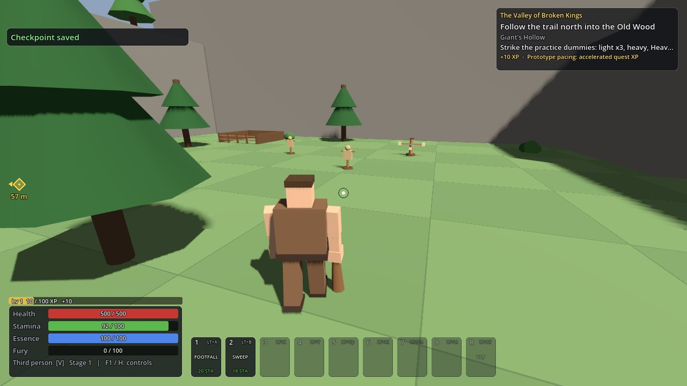
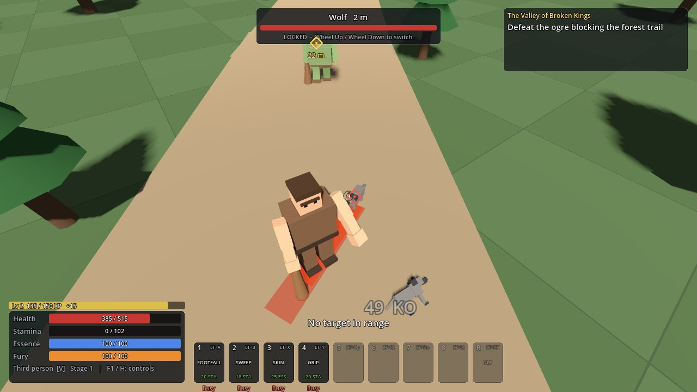
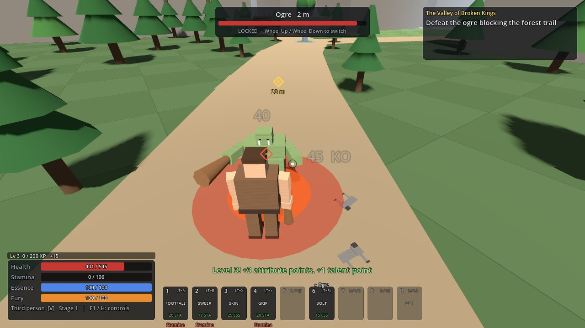
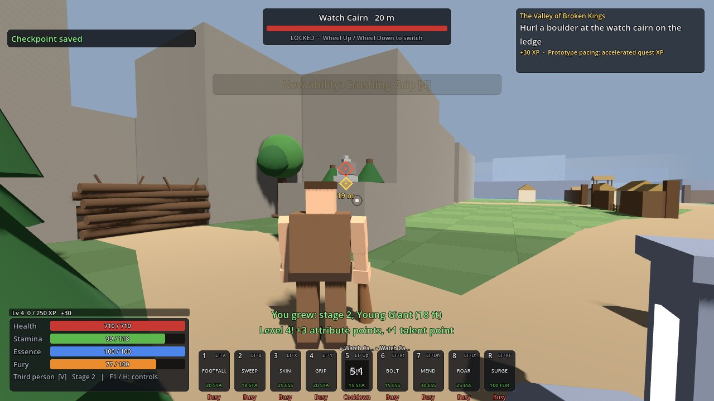
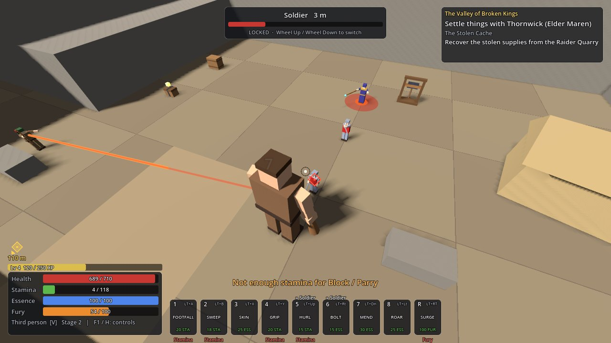
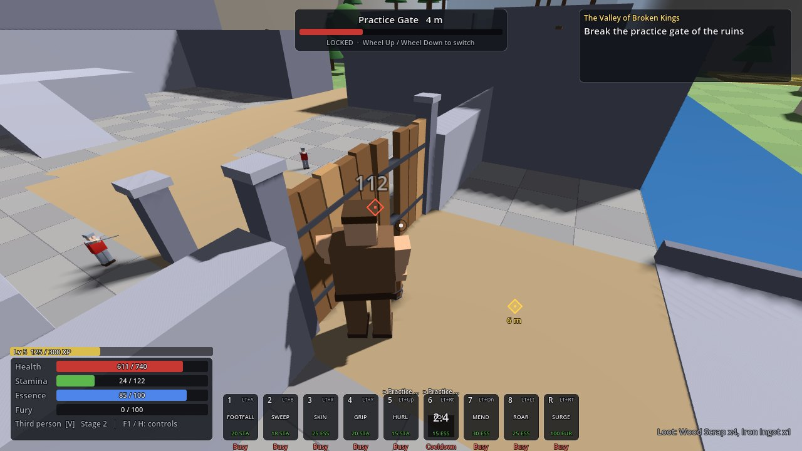
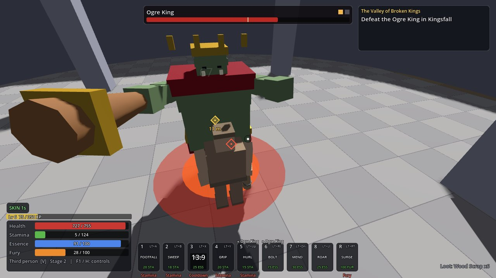
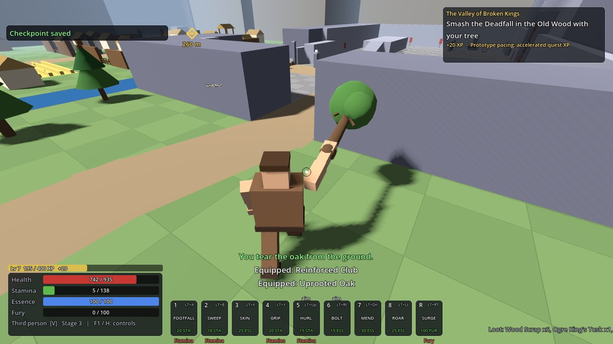
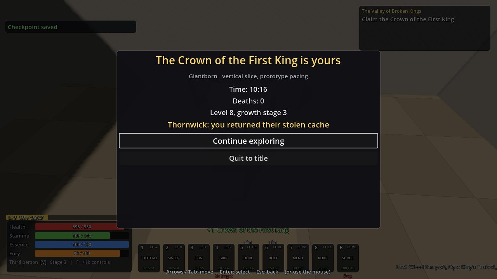
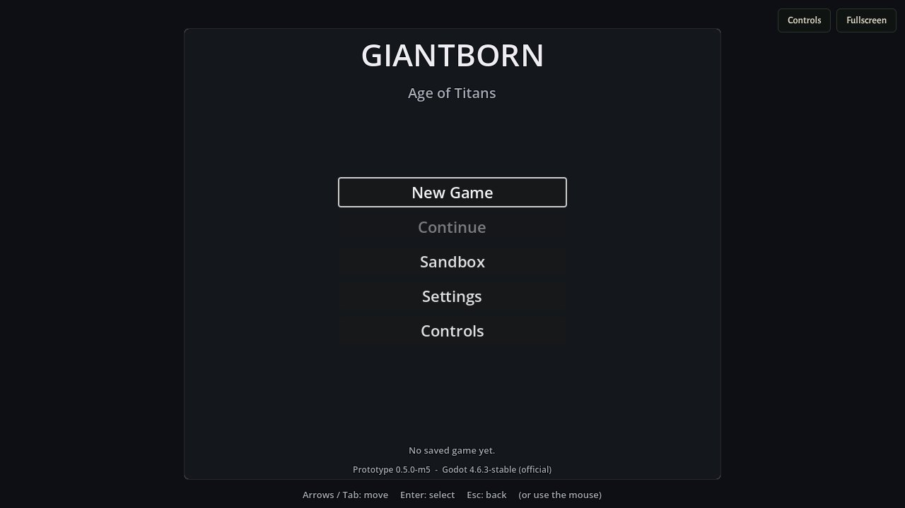

# Giantborn: Age of Titans

Giantborn: Age of Titans is a single-player fantasy action RPG about growth. You begin as a
juvenile giant twice human height; the full design grows you over 20 levels and 10 physical stages
into a 140-ft titan ([docs/GIANTBORN_SPEC_V2.md](docs/GIANTBORN_SPEC_V2.md)).

**This repository holds the playable prototype through milestone M9, version `0.9.0-m9`**: a
campaign in two levels.

- **The Valley of Broken Kings** is the tutorial and prologue, a 400 x 400 m valley designed for 20-30
  minutes of play. You wake 12 feet tall in Giant's Hollow, learn to fight on dummies and a sparring
  post, cross the Old Wood, grow to 18 ft at the Grove Shrine, settle things with the village of
  Thornwick (help it, cow it or force your way), defeat the Ogre King at Kingsfall, grow to 26 ft and
  claim the Crown of the First King. The crown opens the Kings' Door behind its altar.
- **The Old Kingdom** is a streamed open world of 2 x 2 km in five regions (the Crownmarch, the
  Greywood, the Drowned Steps, the Aldmere March and the Stonehold), seen from the Kingsgate shelf to
  the far highlands. You relight the Kingsgate beacon and grow to stage 4 (36 ft), choose an ancestry
  (Stoneblood, Stormborn or Wildheart) and spend talent points in three trees, then win two of three
  oaths in any order, each in a peaceful or a violent way (Brannock's by help, fear or force; the
  Greywood's by driving the Troll Matriarch out or slaying her; Aldmere's by parley, sabotage or a
  breach). You grow to stage 5 (48 ft) after the first oath and to stage 6 (62 ft) at the Standing
  Stones after the second, enter the Moot, face Harrok the Unbowed and take the Stone Throne. On the
  way: towns that treat a giant as a neighbour or a threat, pike and shield formations with banners,
  siege engines and cavalry, trolls that close their wounds unless they burn, rival giants, three
  bosses (the Troll Matriarch, the Iron Regiment and Harrok), size gates and sealed places to come
  back to, a map, a compass, fast travel, and a living world of wandering bands, raids, an army column
  and a siege.

Every sound is original and generated by committed code (`tools/audio/`). Graphics are
flat-coloured boxes on purpose. The M1 combat sandbox is still there for practice.

- **Play it in a browser:** <https://claude.ai/artifact/2UYupKVL1xE6pttiZ6NLqe> (the play link: private
  until it is shared from the page's Share menu; needs a keyboard and mouse; see
  [Browser build](#browser-build-the-play-link)).
- **How it plays**, measured by bots that play the Valley and the whole campaign:
  [docs/HOW_IT_PLAYS.md](docs/HOW_IT_PLAYS.md).
- **The handoff** (what was built, the milestone gates with their evidence, known bugs, what to run
  on your PC): [docs/M6_M9_HANDOFF.md](docs/M6_M9_HANDOFF.md); the earlier ones are
  [docs/M2_M5_HANDOFF.md](docs/M2_M5_HANDOFF.md) and [docs/M1_HANDOFF.md](docs/M1_HANDOFF.md).

| | |
| --- | --- |
|  |  |
| New Game: Giant's Hollow, the quest tracker, the first tutorial prompt and the objective marker | The Old Wood: a wolf's lunge telegraph (the red strip fills as it winds up), one wolf down, the forest ogre coming |
|  |  |
| The forest ogre's smash: a circle to leave before it fills; its long recovery is the punish window | Grown to stage 2 (18 ft) at the Grove: Boulder Hurl locked on the watch cairn on its ledge |
|  |  |
| The quarry raiders (the help path): an archer's aim line, committed before the shot | The ruins' practice gate, cracked: structural damage that saves with the game |
|  |  |
| The Ogre King at Kingsfall: boss bar, phase pips, the slam's telegraph | Stage 3 (26 ft) with an uprooted oak on the way back to the Deadfall |
|  |  |
| The Valley's end screen (since M7 it reads "Prologue complete", with Continue) | The play link's title screen (the browser build, in Chromium, at `0.5.0-m5`) |

*(The Valley's shots were rendered by the game itself while the Valley bot played the help_cache
path (`tools/valley_tour.gd`, software OpenGL under a virtual display, the desktop's `medium`
preset), at milestone M5; the tenth is the browser build in Chromium, which always uses the `low`
preset. ⟦SHIP: one sentence on how the world's shots were rendered: the tour's script, the renderer, the preset, and that they show `0.9.0-m9`, the final code⟧ The M1 sandbox's shots are in [docs/screenshots/sandbox_m1/](docs/screenshots/sandbox_m1/).)*

⟦SHIP: the world tour's screenshots (the Kingsgate shelf's view first, then a formation, a siege engine, a boss, the map), rendered on the final code beside the world bot by the ship step into docs/screenshots/ (numbered from 11 on), appended as rows of the gallery table above, after the end-screen and browser row, with captions⟧

---

## 1. Requirements

| Item | Version |
| --- | --- |
| Engine | **Godot 4.6.3-stable**, standard build (GDScript, not .NET). Download: <https://godotengine.org/download/archive/4.6.3-stable/> (Windows: the 64-bit standard ZIP). |
| Renderer | Compatibility (OpenGL 3.3; WebGL 2 in the browser), set in the project. |
| OS | Windows 10/11 is the target; development and testing were done on Linux. |
| Plugins, paid assets, online services | None. |
| Only for the tools (never to play, build or export the game) | The audio pipeline: Python 3 with numpy, and ffmpeg with libvorbis (the reference toolchain is recorded in `assets/audio/manifest.json`: Python 3.13.18, numpy 2.5.3, ffmpeg 6.1.1, libvorbis 1.3.7). The web checks: Node.js with Playwright's Chromium. |

Use exactly 4.6.3. A newer 4.x editor offers to convert the project; don't accept that until the
engine is deliberately upgraded.

## 2. Run it

**From the editor:** Godot 4.6.3 → **Import** → this folder's `project.godot` → **Import & Edit**,
wait for the first import, then **F5**. **From a command line:** `godot --path .` (Windows:
`Godot_v4.6.3-stable_win64.exe --path C:\path\to\Giantborne-Age-of-Titans`).

The game opens at the **title screen**: **New Game** (the Valley; asks before replacing a saved
game), **Continue** (the last checkpoint, in whichever level it was), **Sandbox** (the M1 arena),
**Settings**, **Controls**, **Quit**. When the saved game has finished the prologue, New Game asks
whether to **Play the prologue** or **Skip to the Old Kingdom** (both replace the save).

Shortcuts after `--`:

| Option | What it does |
| --- | --- |
| `--mode=valley --new-game` / `--mode=valley --continue` | A new campaign in the Valley / the saved game |
| `--mode=world --new-game` | A new game in the open world: the giant wakes on the Kingsgate shelf as the Valley's worst outcome leaves it (stage 3, level 6, the base club, 1 iron) |
| `--mode=world --continue` | Continue the saved game |
| `--mode=sandbox` | The M1 combat sandbox |
| `--start=<checkpoint id>` | A new game starts at that checkpoint (debug, tests, the web checks) |
| `--graphics=low` / `--graphics=medium` | Fix the graphics preset for one run |
| `--no-audio` | Run with the sound engine off |

**The launcher's "Start in the open world"** button on the play link does the same as
`--mode=world --new-game` in the browser: the first press only arms it (it replaces the game saved in
that browser), the second starts it.

If a data file has an error, the game lists every validation error instead of starting. Fix the
named JSON file and run again.

**Saves.** One slot, written at every checkpoint: the first visit to a shrine or waystone, resting,
opening a shrine, a choice made at a shrine (talents, the ancestry, attribute points), every growth,
a boss's end, every main quest stage and every oath. No checkpoint is taken while a boss fight or a
battle is engaged. Death reloads the last checkpoint with at least 60 % health; nothing is lost. The
file is `user://saves/valley_1.json` (Windows: `%APPDATA%\Godot\app_userdata\Giantborn- Age of Titans\saves\`;
Linux: `~/.local/share/godot/app_userdata/Giantborn- Age of Titans/saves/`; the browser keeps it in
its own storage). The save format is schema 2: a save of the `0.5.0-m5` build (schema 1) is migrated
when it loads, and a finished prologue continues with the Kings' Door open. A damaged save falls
back to its backup with a message; a save written by a newer build is refused and kept aside.

## 3. Controls

All bindings can be changed in **Esc → Controls** (or the title's Controls page): click a binding,
then press the new key or button. **F1** or **H** shows the controls for your current loadout in
the game. Button prompts follow the last device you used (Settings → Button prompts). The table is
`data/input/default_bindings.json`.

| Action | Keyboard / mouse | Controller |
| --- | --- | --- |
| Move / look | W A S D / mouse | Left / right stick |
| Light attack (a 2- or 3-hit chain, by weapon) | Left mouse | RB |
| Heavy attack | **Shift + left mouse** | RT |
| Block (tap just before a hit = parry) | Right mouse | LB |
| Dodge / jump | Space / F | B / A |
| Sprint | Hold Shift while moving | Left-stick press |
| Interact: talk, use a shrine or forge, pick up, **grab** a staggered enemy (at 62 ft a siege engine), put it down, heave a rockfall | E | X |
| Throw what you hold | Light or heavy attack | RB or RT |
| Lock target / switch target (at stages 4-6 a formation locks as one target; its banner is a target of its own) | Tab / mouse wheel while locked | Right-stick press / right-stick flick |
| Camera zoom (third person, not locked) | Mouse wheel | — |
| Third / first person | V | D-pad up |
| Ability slots 1-8 | 1-8 | LT + A / B / X / Y, LT + D-pad up / right / down / left |
| Titan Surge (ultimate, 100 fury) | R | LT + RT |
| **Map** (fast travel from a visited waystone or shrine) | **M** | **D-pad down** |
| **Journal** (quests, oaths, sealed places, regions) | **J** | **D-pad right** |
| **Track the next quest** | **T** | **D-pad left** |
| **Pin a place on the map** (shown on the compass) | **P** on the map, or right-click the map | **Y** on the map |
| Inventory, attributes | I | Back |
| Pause, settings, rebinding | Esc | Start |
| Controls overlay | F1 or H | — |
| Confirm on the death screen (load the last checkpoint; the sandbox restarts) | Enter | A |
| **Debug builds only:** debug panel, sandbox reset, grow / shrink a stage, +100 XP, reload the checkpoint | F3, F5, F6 / F7, F8, F9 | — |

With LT held the face buttons and the D-pad fire ability slots instead of their usual actions, and
RT fires the ultimate; on its own the D-pad opens the map and the journal and tracks the next quest.
Holding block keeps you blocking, but only a fresh press opens the parry window. When a boss yields,
the yield prompt asks you to **hold** Enter, the mouse button or pad A on Spare or Strike, so no blow
can decide it. Menus work with the arrows, Tab and Enter, or with the D-pad, A and B (LB / RB switch
tabs). Release exports have no debug keys.

## 4. The campaign

### 4.1 The Valley (the prologue)

| Segment | Where | What happens |
| --- | --- | --- |
| 1. Giant's Hollow | The start | Both cameras (V), the dummies (light chain, heavy, Heavy Footfall), lock-on, the sparring post (block, parry, dodge), the first shrine. The tutorial is optional. |
| 2. The Old Wood | North | A wolf pack (dodge the lunge, then punish), level 2 (Stone Skin, Crushing Grip), two soldiers that guard their front (break the guard, grab a staggered one with E and throw it), the forest ogre (punish its recovery). |
| 3. The Grove | East of the wood | Level 3, **growth to stage 2 (18 ft)** at the shrine, Boulder Hurl at the watch cairn on the ledge, Runic Bolt. The Deadfall blocks the way north. |
| 4. Thornwick | The village | Outmatched soldiers hold a line and brace. Elder Maren asks for help: **bring back the supply cache** from the quarry raiders, or **drive the ogre out of the fields** (both: XP, two iron ingots for the forge, Ancestral Mend), or **intimidate** her (stage 2: Thunder Roar, no iron), or **smash the barricade** (the village turns on you, and an ambush waits on the way back). |
| 5. The ruins | Across the King's Bridge | The practice gate cracks, then breaks; the courtyard garrison (a formation, an archer on the wall, a mage); the armory's sword and the Giantforge (reforge a weapon for 2 iron so it fits stage 3). Level 4: Mend, Roar, Titan Surge. |
| 6. Kingsfall | South of the ruins | The Ogre King: phase 1 alternates a blockable combo and an unblockable slam; at half health he roars and starts charging - make him hit a pillar or the wall, then punish. |
| 7. The return | Back west | **Growth to stage 3 (26 ft)**, uproot an ancient oak, scatter the patrol on the bridge (soldiers flee from a giant four times their height), smash the Deadfall with the tree, defeat the Barrow's wardens and claim the crown. The end screen, "Prologue complete", names your choice at the village; **Continue** leaves you beside the open Kings' Door. |

Back in the Valley later: the sealed Citadel breaks open to a 36-ft giant (its hall holds a hoard and
a stair up to the world's Broken Stair), and a 48-ft giant can heave aside the rockfall over the
First King's vault.

### 4.2 The Old Kingdom (the open world)

| Stage of the main thread | Where | What happens |
| --- | --- | --- |
| The opening | The Kingsgate shelf, the beacon hill | The view over the five regions; drive the scouts off the hill and relight the Kingsgate beacon; **growth to stage 4 (36 ft)** at the Kingsgate Shrine; choose an ancestry at a shrine. Heavy Footfall and Boulder Hurl evolve into Titan Stomp and Crag Hurl. |
| The oaths | Brannock (the march), Hollowmere (the wood), the war camp (the crown) | Three powers ask for an oath; any two complete the stage, in any order. The march: help Brannock (the toll fort and the Raiders' Hollow), cow it, or break its gatehouse. The wood: slay the Troll Matriarch in her den, or burn her three nests and drive her out. The crown: breach Fort Aldmere and fight the Iron Regiment until Warlord Corvane yields, wreck the seven war engines of the camp and Ballista Ridge, or bring the herald a token (Brannock's banner, the deserters' word, Stoneblood blood or 48 ft) and sound the parley horn. |
| Stage 5 | The Greywood, the Sunken Steps or Aldmere's shrine | After the first oath: **growth to stage 5 (48 ft)**, Formation Sweep and Titan Roar; heave rockfalls, wade the deep channel. |
| Stage 6 | The Shrine of the Standing Stones | After two oaths: **growth to stage 6 (62 ft)**, Earthquake and Rampart Grip; seize and throw siege engines. Below 62 ft the Giant's Stair turns you back: go round by the Ironway. |
| The finale | The Moot, the Stone Throne | Enter the Moot, settle the clans' champion Harrok the Unbowed in its ring (spare him, slay him, or talk when all three powers and Skarn stand behind you), and take the Stone Throne. The campaign's end, "The Giant King", names every outcome; Continue leaves you free to roam. |

Off the main thread: the King's Road toll (pay, cow or breach), Millford's millrace and the wolves of
the Barrow Fields, the Shepherd's Watch beacon, the Needle and the Hidden Grove, the great pines
(stage 4 uproots one as a weapon), the woodcutters' camp, Wenna's five sunken bells, the sunken vault
and the Titan Forge, the deserters at the burned mill, Ballista Ridge, Skarn and its siege, and the
Old Kings' cairns (one attribute point each). Places give discovery XP the first time you reach them
(the Kingsgate, Greywood and Aldmere shrines give none: the shrine is the reward); vistas reveal the
places around them on the map; sealed places (a rockfall, a statue, a ledge) are logged in the
journal with the stage they need.

**Weapons and forges.** The club, the sword and the hammer fit stage 2; reinforcing one (2 iron at
an iron-tier forge, such as the Kingsgate anvil) makes it fit stage 6 with its family's stage 4-6
moveset. The Woodcutter's Greataxe fits stage 6 as found, with its own stage 4-6 moveset, and the
Stoneknuckles and the great pine fit stages 4-6; none of the three has a reinforcing step. In the
stage 4-6 movesets the third light of the club, the sword and the Greataxe sweeps out from the
giant's feet; the Stoneknuckles' third light seizes a staggered foe in reach, and the hammer's and
the trees' chains have two blows. Titanforging (2 titan iron and 2 iron at a titan-tier forge) adds
damage and one perk to a reinforced weapon, the Greataxe or the Stoneknuckles; the trees are never
forged.

**The living world.** Each region has a table of wandering bands that spawn out of sight on loaded
ground, filtered by your stage and your standing with its peoples (a band's kill XP falls to nothing
after its third spawn); raiders fall on Millford, Aldmere's army column marches the roads, and the
siege of Skarn waits for you. Walk out of a boss's arena and the fight starts over (the screen warns
you first), except in Fort Aldmere's bailey, whose portcullis drops behind you until the Iron
Regiment is beaten.

Quest XP is accelerated on purpose ("prototype pacing"). Shrines heal, save, grow you, change your
loadout, spend attribute and talent points and offer the ancestry; growth happens only at shrines.
A weapon fits up to a stage: above it the HUD says it is too small until a forge refits it.

## 5. Combat basics

- Attacks cost stamina (light 8, heavy 22, dodge 18, block 5 on entry, sprint 8/s); stamina comes
  back at 15/s after 1 s without spending. Abilities cost stamina or essence and have cooldowns;
  the hotbar shows why one is unavailable.
- Block covers your front 120°. Pressing block within 0.20 s of a hit is a **parry**: no damage,
  and the attacker takes 40 poise (a soldier staggers). Dodge makes you invulnerable from 0.10 to
  0.30 s. Unblockable blows must be dodged: the Ogre King's slam and charge; Harrok's chop, his
  shoulder charge, the last stroke of his frenzy and the stones that fall into his ring; the
  Matriarch's stomp; a rival giant's overhead chop and shoulder charge.
- Every enemy blow with a long windup shows a **telegraph** on the ground that fills as it winds up;
  archers, mages and ballistae show an aim line, a catapult's stone falls in its circle, and a rider's
  charge runs down a line. An arrow at the screen's edge warns of a threat you cannot see, and a
  short sting sounds from its direction.
- Growth adds health, reach and new tactics on both sides: at stage 2 soldiers hold formation and
  brace; at stage 3 they break and flee. From stage 4 humans fight in **formations**: a pike or
  shield wall braces as one band at your shins (step out of the band drawn on the ground); its
  banner halves its fear, so break the banner and it routs. A peaceful town warns you at the first
  blow on its people or its houses and turns hostile at the second; a hostile town can be reconciled
  for a price. The toll-riders and Harrok's clan are hostile from the start.
- **Siege engines** are crewed: break them, scatter their crews, or at 62 ft seize one and throw it.
  **Trolls** close their wounds unless they burn: break a brazier or bonfire beside one, or throw it
  into the flames. A boss may **yield**: from then on no blow lands on it, and the yield prompt asks
  whether to spare or strike.
- Fury fills from basic attacks, parries and kills; at 100, Titan Surge adds 25 % damage and poise
  for 6 s. The library holds 24 active abilities and Titan Surge: the Valley's eight, six that
  evolve from them as you grow, seven from talents and three ancestry signatures.

**Sound.** The Valley, every region and every boss have their own score, and the Valley and every
region their own ambience. Towns, camps and the giants' halls have no score of their own: they keep
the music of their region (or the Valley) over a bed of their kind (the village's, the town's, the
camp's, the giants' hearth; Hollowmere keeps the Greywood's), and a boss fight changes the music, not
the ambience. Music follows the place and the fight, and you can hear threats coming. The volumes
(master, music, ambience, effects, interface) are in **Settings → Audio**, and the sound mutes while
the window (or the browser tab) is in the background. Nobody has listened to it on speakers yet:
every audio check here is a measurement (`docs/USABILITY_SCRIPT.md` §8 is the owner's listening
sheet).

## 6. Tests, bots, measurements and the audio pipeline

Every Godot command for tests goes through `tools/gd.sh`, which gives the worktree its own
`user://` folder (`.userdata/`).

```bash
tools/check.sh                          # import, import, the default tier, the 120 s soak
tools/check.sh --build --slow --gate --audio   # the whole check: every scene and the world rebuilt
                                        # (no diff wanted), the audio pipeline, all three tiers, the soak
tools/check.sh --only=world --build-args=--chunks=c2_6   # rebuild chunk c2_6 and its neighbours, seams checked
tools/run_tests.sh                      # the default tier only; add --slow, --gate or --filter=<part of a path>
```

There are three tiers (DECISIONS.md decision 64): the **default** tier (`tests/unit`, `tests/integration`:
pure rules, real scenes, physics and input events; silent; its budget 75 s of wall time), the
**slow** tier (`tests/slow`: the Valley, routes, the real world's builds and walks, batteries;
budget 8 minutes) and the **gate** tier (`tests/gate`: walkthroughs of every region, every order of
the oaths, seeded boss runs, determinism soaks, the world bot's smoke run; budget 50 minutes). The
suites print one line each, a `TIMES` line and `RESULT: N suites, N checks, 0 failures`; any engine or
script error during a test fails it. `tools/check.sh --audio` adds the audio pipeline's own tests and
regenerates every sound bit-exact (below).

**The bots** play the game headless (novice or expert, optionally assisted: damage taken x0.25):

```bash
tools/run_bots.sh help_cache:novice:1:assist      # one Valley run; policy:skill:seed[:assist]
tools/run_bots.sh w.peaceful:novice:1             # one world run (w.peaceful, w.conqueror, w.mixed,
                                                  # w.order_march, w.order_wood, w.order_crown, w.campaign)
tools/run_bots.sh --preset=assisted               # the Valley's four village outcomes, assisted
tools/run_bots.sh --preset=stability              # the Valley's 30-minute run
tools/run_bots.sh --preset=balance                # the Valley's balance matrix
tools/run_bots.sh --preset=world_assisted         # the three world presets, assisted (the M9 acceptance)
tools/run_bots.sh --preset=world_orders           # each oath first, assisted
tools/run_bots.sh --preset=world_balance          # the world's balance matrix (21 runs)
tools/run_bots.sh --preset=world_stability        # the 60-minute world run
python3 tools/bot_report.py ".userdata/godot/app_userdata/Giantborn- Age of Titans/bot_runs/<tag>" [section]
```

`bot_report.py` prints every table of a batch, or the sections named after its folder: the Valley's
(`summary`, `runs`, `segments`, `deaths`, `growth`, `abilities`, `perf`, `stuck`, `states`,
`targets`) or the world's (`world_summary`, `world_runs`, `world_segments`, `world_outcomes`,
`world_bosses`, `world_travel`, `world_streaming`, `world_formations`, `world_siege`, `world_music`,
`world_deaths`, `world_stuck`, `world_growth`, `world_lone`, `world_targets`, `world_perf`,
`world_states`).

**Performance** (`docs/PERFORMANCE.md` has every command, the budgets and the results):

```bash
tools/gd.sh --headless --path . --fixed-fps 60 -- --no-user-settings \
  --level=res://scenes/test/stress_arena.tscn --scenario=stress --autoplay=300 --graphics=low
tools/gd.sh --headless --path . --fixed-fps 60 -- --no-user-settings \
  --mode=valley --new-game --scenario=valley_walk --autoplay=900 --graphics=low
tools/gd.sh --headless --path . --fixed-fps 60 -- --no-user-settings \
  --mode=world --new-game --scenario=world_walk --autoplay=60    # the world's default route
```

On your PC, run the exported build **without** `--fixed-fps` (real frame times):
`Giantborn.console.exe --resolution 1920x1080 -- --no-user-settings --level=res://scenes/test/stress_arena.tscn --scenario=stress --autoplay=300 --graphics=low`
prints `frame_ms`, `gpu_render_ms` and `draw_calls` percentiles in its `PERF_RESULT` line.

**Screenshots** (need a display; on Linux `xvfb-run` provides one): `tools/capture_tour.sh` (the M1
sandbox), the Valley tour beside the Valley bot:

```bash
xvfb-run -a -s "-screen 0 1280x720x24" tools/gd.sh --path . --resolution 1280x720 \
  --audio-driver Dummy -s res://tools/valley_tour.gd -- --no-user-settings \
  --save-dir=user://tour_saves --mode=valley --new-game --scenario=valley --bot-assist \
  --bot-village=help_cache --autoplay=2400 --tour-dir=/absolute/folder
```

and the world tour beside the world bot, which rendered the gallery's world shots: ⟦SHIP: the world tour's command as the ship step ran it for the gallery (its script, the world bot's options, --tour-dir), as a bash block like the Valley tour's - the command the handoff's §6.3 gives⟧

**The audio pipeline** (`tools/audio/`, Python 3 with numpy, seeded, float64, single-threaded) writes
every sound: the effects as WAV masters (committed: they are Godot's import source), the music and
ambience rendered to lossless masters and encoded with libvorbis's bit-exact flags, of which only the
Ogg files are committed, beside `assets/audio/manifest.json` (generator, seed, parameters and the hash
of every master and every shipped file) and `assets/audio/PROVENANCE.md`.

```bash
python3 tools/audio/build_audio.py --verify       # regenerate every master and Ogg, compare every hash
python3 tools/audio/build_audio.py --budget       # the size and registered-seconds budgets
python3 tools/audio/build_audio.py --only=music   # rebuild one family (then commit the outputs)
python3 tools/audio/build_audio.py --masters-out=<dir>   # the music and ambience masters as FLAC
python3 tools/audio/test_synth.py                 # the pipeline's own tests
```

Building or playing the game never needs Python or ffmpeg.

## 7. Export

1. Install the export templates once: **Editor → Manage Export Templates → Download and Install**
   (4.6.3).
2. **Project → Export…** → **Windows Desktop** (or **Linux**, **Web**) → **Export Project**.

The presets in `export_presets.cfg` write to `builds/`, include `data/**/*.json` and exclude
`tests/` and `tools/`. The **Web** preset (the play link) also leaves out the test content
(`scenes/test/`, `assets/test_world/`, `data/test/`); **Web (test)** keeps it for the web checks that
need it. From a command line:

```bash
godot --headless --path . --export-release "Windows Desktop" builds/windows/Giantborn.exe
godot --headless --path . --export-release "Linux" builds/linux/Giantborn.x86_64
```

Run exports (and `tools/build_web.sh`) with plain `godot`, not `tools/gd.sh`: the export templates
live in Godot's default data folder, which `gd.sh` replaces with the worktree's own. Windows also
gets `Giantborn.console.exe`, which prints to the console (use it for the measurement runs). Release
exports have no debug panel or debug keys.

### Browser build (the play link)

The play link is the **Web** preset (single-threaded, so it needs no special server headers),
hosted as an Artifact page. `web/launcher.html` is that page: a poster, the Play and "Start in the
open world" buttons, the controls, notes on the build and a loader. The host serves files of up to
16 MB and no archives, so the engine (`index.wasm`, about 36 MB) and the game data (`index.pck`) ship
gzipped and base64-encoded as `.txt` files, the game data in parts of at most 15 MB, and the launcher
joins and unpacks them in the browser.

```bash
tools/build_web.sh                       # the release into builds/web/ (fails over the milestone's
                                         # pck budget: 23 MB shipped from M8; --budget-mb=N overrides)
tools/build_web.sh --preset="Web (test)" # with the test content, into builds/web_test/
tools/build_web.sh --parts=2             # force the pck into two parts
tools/build_web.sh --check-size=DIR      # judge an earlier build's pck without exporting
```

The script packs the files, copies the poster and writes the byte counts and the number of parts into
`web/launcher.html`. To try it locally, serve the folder with any static web server (for example
`python3 -m http.server -d builds/web 8000`) and open `http://localhost:8000/play.html`
(`play.html?args=a,b` passes engine arguments). To update the play link, republish
`web/launcher.html` to the same artifact URL with these files from `builds/web/`: `index.js`,
`index.wasm.gz.b64.txt`, the packed pck (`index.pck.gz.b64.txt`, or its parts
`index.pck.gz.b64.1.txt`, `.2.txt`, ...), `index.audio.worklet.js`,
`index.audio.position.worklet.js` and `poster.jpg`.

The web checks drive the build in headless Chromium (Playwright): `node tools/web/audio_check.mjs`
(the Valley's music), `node tools/web/stream_check.mjs --build=builds/web --world --audio` (a walk
across region borders with the music recorded; without `--build` it uses the `Web (test)` build in
`builds/web_test/`), `node tools/web/world_check.mjs` (a world save Continued, a fast travel and a
walk with the music recorded) and `node tools/web/world_start_check.mjs` (the launcher's two start
buttons). On a machine with a GPU, add `--strict` to the first three (the checks that record the
music): the plan's audio criterion (no silent run over 50 ms in the music) only counts there.
`world_start_check.mjs` takes no `--strict`.

In the browser: click the game (or a title button) to take the mouse; the first **Esc** gives it
back and pauses, because the browser keeps that key for itself. **H** shows the controls (F1 may
open the browser's help). Browsers start a page's sound only after a click or a key press. The
browser build always uses the low graphics preset, keeps its save and settings in that browser, and
has no Quit button.

## 8. Project layout

```
data/        JSON content (validated at startup): abilities and actions, statuses, the player,
             ancestries and growth (stages 1-6), enemies, NPCs, props, weapons, items, loot, shrines,
             talents, progression, quests, dialogue, tutorial prompts, the world (levels, regions,
             places, encounters, factions, wander tables, world events), audio (banks, the mix, music
             and ambience sets, audio regions), input bindings; data/test/ holds the test levels' records
scripts/     core (autoloads, data, saves, session) · combat · adapters · actors (+ player components)
             · ai (brains, formations) · world (levels, the streamed world, navigation, the director,
             props, interactables, bosses, the living world) · progression · quests · audio ·
             presentation · debug (autopilot, the Valley and world bots, perf probe)
scenes/      generated: main, the giant, enemies, NPCs, world props, siege engines, the sandbox, the
             Valley and its districts, the world's root scene and its chunks' prop parts, test levels
ui/          HUD and its widgets, the screen stack and every screen (map, journal, yield, ancestry...)
assets/      materials, shaders, the Valley's navmeshes, the world's chunks, navmeshes, structures,
             skyline, index and map, the generated audio with its manifest and provenance
tests/       unit/, integration/, slow/, gate/, support/, fixtures/ (saves), and the runner
tools/       gd.sh, check.sh, run_tests.sh, run_bots.sh, bot_report.py, build_web.sh, the scene
             builders and SceneKit, the Valley and world layout tables (tools/data/), the world builder
             library (tools/world/), the audio pipeline (tools/audio/), the web checks (tools/web/),
             the screenshot tours, probes
web/         launcher.html: the page behind the play link
docs/        spec, plans, architecture, decisions, handoffs, how it plays, performance, usability,
             balance log, one system document per package
```

Gameplay numbers live in `data/` and are validated at startup. Scenes are generated by
`tools/build_scenes.tscn` from the builders in `tools/builders/` (the Valley from
`tools/data/valley_layout.json`, the world from `tools/data/world/*.json`); **once you edit scenes in
the editor, don't re-run it**, because it overwrites them. How the code fits together:
[docs/ARCHITECTURE.md](docs/ARCHITECTURE.md). Every interpretation of the spec and every deviation
from it: [docs/DECISIONS.md](docs/DECISIONS.md).

## 9. Known limitations

- **Placeholder visuals.** Boxes with procedural animation; far people and giants become plain
  boxes (the distance level of detail); faint seams can show in the distant haze where the loaded
  hills meet the skyline; no motion blur.
- **No human has played these builds yet**, and they have not run on real hardware: the usability
  sessions, the listening pass, a timed human run, a real gamepad, Windows, real-GPU frame times and
  real desktop browsers are the owner's to run (`docs/USABILITY_SCRIPT.md`, `docs/PERFORMANCE.md`).
  Everything here was measured in a Linux container with a software renderer and no speakers.
- **Balance and pacing are a bot's.** Bots play the whole campaign, but they walk from objective to
  objective without exploring, so their time is a floor, and some fights are harder or easier for
  them than they will be for a person. `docs/HOW_IT_PLAYS.md` ("Known issues") lists where they
  still struggle, and [docs/M6_M9_HANDOFF.md](docs/M6_M9_HANDOFF.md) §8 the open items.
- **Browser build.** Single-threaded: on a slow machine the music can stutter while frames are slow
  (the build mixes its sound on the main thread) and the world may take more than its 8 s to load its
  first ground; tested only in Chromium with software rendering; a gamepad may not be detected inside
  the hosting page.
- **Streaming in the editor and headless runs** parses the world's largest prop parts as text scenes:
  the three largest take 11.8-12.7 ms each (median of three; two over plan §6.4's 12 ms for a
  streaming work frame), and the W23 confirmation's headless world walk had its worst work frame,
  12.19 ms, on one such parse (`docs/PERFORMANCE.md`, "The M9 confirmation"). Exported builds ship
  them as binary scenes, and the same parts saved as binary parse in at most 1.2 ms (0.88 ms for the
  largest, `c1_2_0`). The parse times were measured at W23 by lane P39f's probe
  (`docs/systems/P39f.md`, "The heaviest streaming step").
- **Not built yet** (`docs/plans/M6_M9_PLAN.md` §0.4): growth stages 7-10, boss grapples, ability
  ranks, day and night, weather, mounts, swimming, voice acting, localization, several save slots,
  destructible walls and bridges, physics interpolation (on monitors faster than 60 Hz bodies move at
  60 Hz; mouse look stays smooth).
- **Planned but not built** (the full list: [docs/M6_M9_HANDOFF.md](docs/M6_M9_HANDOFF.md) §4.2): the
  siege trains of the wander tables (`docs/plans/M6_M9_PLAN.md` §5.10; an engine is a placed prop, so
  a wandering band cannot bring one along: `docs/plans/FOLLOWUPS.md`), Bulwark's frontal rule (§5.12:
  it takes x0.4 from every side), a horn at a battle's phase change and the watching clans' cheers,
  and two of the plan's fourteen Old Kings' cairns (the Toppled King's and the Barrow Vault's).
- **Smaller gaps.** Button prompts are text (Xbox names); soldiers fleeing together through a gate
  can jam (no crowd avoidance).

## 10. More documents

| Document | What it holds |
| --- | --- |
| [docs/M6_M9_HANDOFF.md](docs/M6_M9_HANDOFF.md) | The M6-M9 handoff: changed files, versions, implemented versus deferred, the gate table with evidence, test results, exports, known bugs, the owner's tasks and decisions, the next milestone |
| [docs/HOW_IT_PLAYS.md](docs/HOW_IT_PLAYS.md) | The bots' measured play of the campaign and the Valley: times, deaths, bosses, growth evidence, music, streaming, stability, what to try first |
| [docs/PERFORMANCE.md](docs/PERFORMANCE.md) | Budgets, tools, commands, container results, the reference-PC and web checklists |
| [docs/USABILITY_SCRIPT.md](docs/USABILITY_SCRIPT.md) | The usability sessions (the Valley and the world), the real-controller checklist, the audio sheet, the world sheets, the real-browser sheet |
| [docs/BALANCE_LOG.md](docs/BALANCE_LOG.md) | Every tuning change, why, and the matrices before and after |
| [docs/ARCHITECTURE.md](docs/ARCHITECTURE.md), [docs/DECISIONS.md](docs/DECISIONS.md) | How it is built; every interpretation and deviation |
| [docs/systems/](docs/systems/) | One document per package (P01-P18, P19-⟦SHIP: P40 once the ship step writes docs/systems/P40.md (plan §1.1 item 5, §3.24; as P18 wrote P18.md), else P39f⟧): APIs, data, decisions, tests, gate notes |
| [docs/plans/M6_M9_PLAN.md](docs/plans/M6_M9_PLAN.md), [docs/plans/M2_M5_PLAN.md](docs/plans/M2_M5_PLAN.md), [docs/plans/FOLLOWUPS.md](docs/plans/FOLLOWUPS.md) | The plans and the review follow-ups |
| [docs/M2_M5_HANDOFF.md](docs/M2_M5_HANDOFF.md), [docs/M1_HANDOFF.md](docs/M1_HANDOFF.md) | The Valley's handoff and the M0/M1 combat sandbox handoff |
| `assets/audio/PROVENANCE.md` | Where every sound comes from |

## 11. Next milestone

**M10: the realistic giant, with a character creator.** It follows `0.9.0-m9`; no plan for it is in
the repository yet. Before it come the owner's checks of this build (the handoff's §9): the usability
sessions in the Valley and the world, the world sheets, the listening pass, the reference PC and real
browsers, a real gamepad; and the owner's two decisions (its §10): a licence for the project and its
generated assets, and whether to commit the lossless music and ambience masters.
